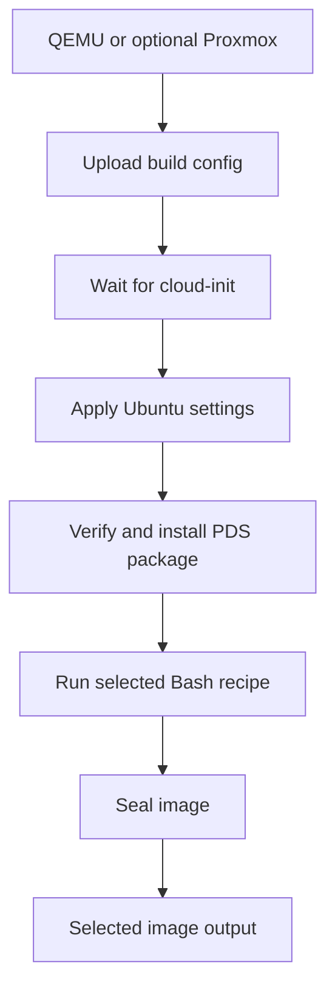

# Ubuntu image preparation

The [QEMU](local-build.md) and [native Proxmox](proxmox.md) builders share the same configuration and
sealing steps. QEMU produces a local qcow2 and optional raw disk; the native builder produces a
Proxmox template. Choose the builder with `-only`.

Both apply the packages, locale, keyboard and timezone in
[build-config.yaml](../../packer/ubuntu/cloud-init/build-config.yaml). Clone-time cloud-init supplies
users, SSH keys, hostname and network identity.

## Script responsibilities

`install.sh` is an image provisioner. It stays a short Bash entrypoint with an explicit config input.
PDS remains the standalone Bash function library. `install-pds.sh` verifies the package/version
and signing-key inputs and records `/var/lib/builders/pds.json`. `run-recipe.sh` loads the installed
library and runs the selected [image recipe](provisioning.md). Native package operations finish
before the recipe's final SSH-policy call. The observer checks SSH service state and exports the
journal before sealing truncates logs; it does not duplicate or reapply that policy.

`wait-cloud-init.sh` uses Bash and `jq`, shared by both builders. It accepts a completed boot with
deprecation notices only; warnings, malformed results and other failures stop the build. The current
noble/amd64 [package manifest](https://cloud-images.ubuntu.com/noble/current/noble-server-cloudimg-amd64.manifest)
includes jq. Recheck that prerequisite when changing the source image. Python is used for the local
regression tests, not for guest provisioning.

`seal-image.sh` is destructive image preparation. Its explicit `--image-build` argument prevents an
accidental invocation from immediately removing keys or resetting identity. Run it only inside a
fresh disposable image-build guest. Packer supplies that argument in the final provisioning step.
Before clearing the machine ID, it runs `systemd-machine-id-setup --commit` to persist and unmount
a transient read-only ID left by early boot. The command is a no-op for a persistent ID; see the
[systemd reference](https://www.freedesktop.org/software/systemd/man/258/systemd-machine-id-setup.html#--commit).
The default Ubuntu account remains with an unusable password and no authorized keys. Its standard
cloud-init sudo policy remains too, allowing the authenticated build session to request shutdown.
Clone-time configuration must supply any usable deployed login; the image does not retain the
build password or key. The account is disabled, not deleted.

`prepare-base-image.sh` customizes a disk on the build host. `create-base-template.sh` transfers a
verified bundle over SSH and runs `import-base-template.sh` on Proxmox using its native tools.
`export-raw.sh` runs on
the build host after a QEMU build when raw output is requested. These scripts are not part of PDS.

## Source and further reading

- [Executable Packer template](../../packer/ubuntu/ubuntu.pkr.hcl) and [variables](../../packer/ubuntu/variables.pkr.hcl).
- [Cloud-init documentation](https://cloudinit.readthedocs.io/en/latest/).
- [Original Ubuntu template](https://github.com/nbarnum/packer-ubuntu-cloud-image): the starting point credited in the earlier guide.
- [Armbian build customisations](../../armbian-build-framework/): separate board-specific images. Ubuntu ARM/HVF and generic QEMU boot recipes for those boards are not verified here.
